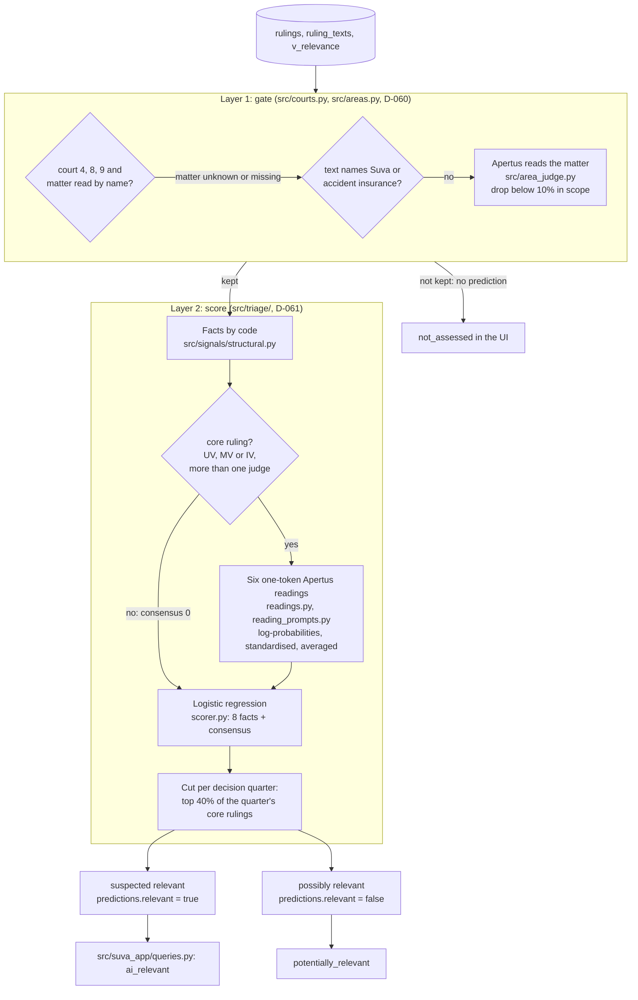

# Cleanup handoff: from four manual commands to one modular end-to-end run

> **Status: handoff, Sat 28 Nov 2026.** Written after a full read-only audit of the repository at commit `043ab5a` (branch `platform/e2e-cleanup`). Nothing has been cleaned or rewired yet: this document is the audit and the plan. Line numbers refer to that commit. Delete this file when the cleanup is merged.

## 1. Where things stand

**Branch.** `platform/e2e-cleanup`, pushed. It contains:

- the local work that was uncommitted on `data-app-research` (ingest, summary workspace, feedback, summary pipeline, judge, UI pages), committed unchanged as `7bca8b2`;
- `origin/main` (`2d127cb`) and the four triage branches `triage/gate-area-codes` (PR #36), `triage/classifier`, `triage/outer-gate`, `triage/mvp-pipeline`, merged as `043ab5a`.

One conflict, in `MODELS.md`: the D-061 scorer row came from the triage branch, the two evaluation-judge rows from the local work.

**Tag.** `archive/pre-cleanup` points at `043ab5a`. Everything section 6 proposes to delete stays recoverable from it.

**Checks at `043ab5a`.**

| Check | Result |
|---|---|
| `uv run --frozen pytest -q` | 3 failed (section 3) |
| `uv run --frozen ruff check src tests` | 295 errors: 247 E501, 14 B008, 8 B905, 7 B006, 6 E702, 13 others |
| `uv run --frozen ruff format --check src tests` | 27 files would be reformatted |
| `make run` | prints `STUB` for every stage and exits 0 |

**Decisions already taken by the team member who asked for this cleanup.**

| Question | Decision |
|---|---|
| Python layout | Stage packages: the gate in its own package, layer 2 in `src/triage`, `summarize.py` split, one absolute import style |
| Unused material (section 6) | Tag first (done), then delete |
| Sub-agents | Up to 6 at once for this cleanup (overrides G8 for this task only) |
| Delivery | Push the branch and open a PR against `main` when `make check` is green |

## 2. How the system runs today

There is no single entry point. The working system is four manual steps.

| Step | Command | Code | Writes |
|---|---|---|---|
| Populate the database | `uv run python -m suva_data pull` then `docker compose up -d db`, or `python -m suva_data build` | `src/suva_data/cli.py:74-149, 236-252` | `rulings`, `source_records`, `ruling_texts`, `conflicts`, `statute_refs`, `labels`, `gold_summaries`, `ingest_runs` |
| Add new rulings | `python -m suva_data ingest --from/--to` or `--since-last`, or `POST /api/updates` | `src/suva_data/ingest.py:155`, `src/suva_app/updates.py:20-24` | the same tables and `ingested_rulings` |
| Relevance (layers 1 and 2) | `make triage MODE=live WRITE=1` | `src/triage/pipeline.py:122-237` | one `model_runs` row, one current `predictions` row per kept ruling |
| Summaries | `python -m src.summarize.pipeline --status ai_relevant --limit N`, or `POST /api/rulings/{id}/summaries` | `src/summarize/pipeline.py:106-150` | `model_runs`, `summaries` |
| Serve | `uv run uvicorn suva_app.main:app --port 8000` | `src/suva_app/main.py` | migrations applied at startup |

**Make targets.** Real: `help`, `check`, `triage`, `smoke-llm`, `warmup`. Stubs that print `STUB` and exit 0: `run`, `run-live`, `serve`, `crawl`, `refit`, `eval`, `eval-private`, `claims` (`src/cli.py:56-76, 120-127`). The Docker `CMD ["make","run"]` therefore prints stubs and exits.

**Web UI.** Vite, React 19, Tailwind in `src/web`. FastAPI serves `src/web/dist` when it exists (`main.py:218-219`), but `dist/` is git-ignored and neither the Makefile nor the Dockerfile builds it (the image has no Node). A fresh clone serves the API only.

**API routes** (`src/suva_app/main.py`).

| Route | Line | Reads / writes |
|---|---|---|
| GET `/api/health` | 54 | `rulings` count |
| GET `/api/facets` | 59 | `predictions`, `model_runs` |
| GET `/api/rulings` | 64 | `rulings`, `v_relevance`, `predictions`, `ingested_rulings`, `gold_summaries`, `summaries` |
| GET `/api/rulings/{id}` | 102 | the same and `ruling_texts`; the UI does not call it (`api.ts:166` uses `/workspace`) |
| POST `/api/rulings/{id}/relevance` | 117 | writes `labels` (`expert_override`), `relevance_events` |
| GET `/api/rulings/{id}/workspace` | 150 | ruling, text, `summaries`, `gold_summaries` |
| POST `/api/rulings/{id}/summaries` | 156 | live Apertus call; writes `model_runs`, `summaries`, `summary_events` |
| PUT `/api/rulings/{id}/summaries/{lang}` | 162 | writes `summaries`, `summary_events` |
| POST `.../{lang}/confirm`, `/unconfirm` | 168, 174 | `summaries.confirmed_*`, `summary_events` |
| POST `.../{lang}/revise` | 179 | live Apertus call; writes `model_runs`, `summaries`, `summary_events` |
| GET `/api/learning` | 185 | `labels`, `summaries`, `summary_events`, `relevance_events` |
| GET, POST `/api/updates` | 197, 202 | `ingest_runs`; POST starts a background ingest |

### The two-layer classification as built



## 3. The three failing tests, with root causes

| Test | Root cause | Minimal correct fix |
|---|---|---|
| `tests/test_doctrines.py::test_no_network_at_import` | `src/summarize/tally.py:12-15` tries `from summarize import blocking…` and falls back only on `ModuleNotFoundError`. The editable install puts `src/` on `sys.path`, so `summarize` resolves to the namespace directory `src/summarize/` (it has no `__init__.py`), which raises `ImportError` instead. | `tally.py` is unused and needs a file that does not exist (`data/trial/holdout10.txt`): delete it with the legacy path (section 6). If it is kept, use the `if __package__:` pattern of `summarize.py:16-19`. Adding `__init__.py` alone does not fix it. |
| `tests/test_models_registry.py::test_every_model_id_in_code_is_in_models_md` | (1) The last alternative of `MODEL_ID` (`:20`) is case-insensitive and matches `bge` and `embed` after any `x/`: `data/bger.parquet` (`suva_data/config.py:94`, `sources/swiss_caselaw.py:28`), `suva-nga/bger-rulings` (`config.py:98`), `docs/CH_BGer` (`sources/entscheidsuche.py:403`). (2) `scanned_files` (`:28-30`) walks `src/web/node_modules`. | Skip `node_modules` in `scanned_files`, and require `bge-` (or a word boundary) in that alternative. These strings are not models: do not add them to `MODELS.md`. |
| `tests/test_no_suva_personal_fields.py::test_no_generated_file_contains_a_d051_value` | The saved output of code cell 9 of `notebooks/01_eda.ipynb` (a crosstab and a group-by on the gold summaries' author column) holds author names, lines 502-600. The cell source is clean. `notebooks/` is untracked (excluded in `.git/info/exclude`), so nothing was committed, and the test passes on a clean clone. | The notebook's owner clears that cell's output locally. Do not add `notebooks/` to the test's skip list: the test is doing its job. |

## 4. Numbers

Sources: `results/*.json` unless marked. Aggregates only (D-031).

### Layer 1 and layer 2 (`results/triage_pipeline.json`)

| Stage | Count |
|---|---|
| Rulings in the run | 6,234 |
| Kept by layer 1 | 1,115 (18%) |
| Listed relevant rulings not kept by layer 1 | 0 of 59 |
| Core rulings read by Apertus, six readings each | 391, none failed |
| Training rulings / relevant among them | 643 / 59 |
| Suspected relevant / possibly relevant (sum of `by_quarter`) | 211 / 904 |

Out of quarter (fit on one listed quarter, apply the cut to the other, folds pooled):

| Submitted | Found | Recall | Precision | F2 |
|---|---|---|---|---|
| 120 | 55 of 59 | 0.932 | 0.458 | 0.772 |

Per fold: Q1/2026 66 submitted, 28 of 31 found; Q4/2025 54 submitted, 27 of 28 found.

Stored per decision quarter (kept / suspected relevant): Q3/2025 23 / 9; Q4/2025 295 / 54; Q1/2026 348 / 66; **Q2/2026 416 / 76**; Q3/2026 2 / 0; Q4/2026 31 / 6.

### Apertus reading the matter (`results/area_judge_court{4,8,9}.json`, 300 rulings per court, seed 1, `area_judge@2`)

| Court | In-scope kept | Out-of-scope dropped | Same decision when repeated | Same matter as the court's rubric |
|---|---|---|---|---|
| 4 | 157 of 158 | 5 of 142 | 50 of 50 | 181 |
| 8 | 178 of 178 | 79 of 122 | 48 of 50 | 268 |
| 9 | 124 of 124 | 153 of 176 | 50 of 50 | 230 |

### The local database (read-only query, 28 Nov, not in `results/`)

| Table | Rows |
|---|---|
| `rulings` | 6,240 |
| `predictions`, current | 1,115 (211 `suspected_relevant`, 904 `possibly_relevant`) |
| `model_runs` | 7 |
| `summaries` | 9 |
| `gold_summaries` | 110 |
| `labels` | 59 |
| `relevance_events` / `summary_events` | 2 / 1 |
| `ingested_rulings` | 185 |

### Numbers in the docs that disagree or have no source

| Where | Problem |
|---|---|
| `docs/LAYER1.md:3,92`, `docs/STATE.md:32`, D-060 | 6,055 rulings and 1,082 kept (the older parquet export). The run and `docs/TRIAGE_PIPELINE.md` say 6,234 and 1,115. Likely cause, not verified: 179 rulings ingested since, of which the 33 extra kept are the Q3 and Q4/2026 rows. |
| `docs/LAYER1.md` §4 | Reason table, "140 read by Apertus, 43 dropped", "82 of 82", "June 154": no `results/` file. The pipeline JSON has no count of layer-1 Apertus readings. |
| `docs/STATE.md:33` | "run 6": the JSON has no `run_id`; the database has 7 runs. |
| Fact count | D-061 says seven facts, `scorer.py:4` eight, `TRIAGE_PIPELINE.md` "nine inputs". `FEATURES` holds 8 plus the consensus. |
| `docs/TRIAGE_PIPELINE.md` | No source for: Apertus alone 0.67 to 0.73, 45 against 79, 0.91 / 0.75, 0.88 / 0.73, 94%, ±0.08. |
| Empty Q2 rubric | `TIPS_LAYER1_FILTER_HANDOFF.md:16` says 1,683 of 2,096; `LAYER1.md:48` and `TRIAGE_OUTER_GATE.md:75` say 442 of 2,096. |
| `docs/TRIAGE_SIGNALS.md` §2, `docs/TRIAGE_OUTER_GATE.md` §4-6, all of the TIPS handoff | No `results/` source (the first two say so themselves). |
| `docs/STATE.md:26`, `docs/DATA_LAYER.md` §0 | "73 passed", "203 tests": about 445 test functions now. |

## 5. The LLM judge

**How it works** (`eval/judge/`, `src/llm/judge.py`).

1. Code checks first (`checks.py`): abbreviations and citation forms of the wrong language, markup, anonymisation placeholders, ß, a repeated sentence, length against the band of Suva's summaries.
2. One yes-or-no call per criterion: 11 criteria in `rubric.json`, version `judge-v3`. Critical: T1, F1, F2, F3, C1.
3. The model lists the units it checked with verbatim quotes. Code recomputes PASS or FAIL from the units and discards an answer that contradicts itself (`core.py:196-199`).
4. A FAIL must quote text that exists in the summary, the ruling or the reference (`:200-209`). A PASS on T2, T3, T4 must quote at least 90% of the sentences (`:212-216`).
5. An unusable answer is retried once (`:325-337`). A FAIL on F1, F2, F4 gets a second confirmation call that can overturn it (`:271-296, 338`).
6. Transport: temperature 0, fixed seed, strict JSON schema, reasoning effort high, three HTTP attempts; it refuses an Apertus model. Answers are cached in `data/derived/judge/cache.jsonl`.
7. Two results per summary: the weighted share of passed criteria, and `usable` (every critical criterion passed).

**Thresholds, written before measuring** (`metaeval.py:31-37`): sensitivity ≥ 0.80, specificity ≥ 0.80, agreement with itself ≥ 0.90, answers without a verdict ≤ 5%, κ against a human ≥ 0.60.

**Run A: `results/judge_metaeval_dev.json`.** `openai/gpt-oss-120b`, rubric `judge-v2`, development split, 8 rulings, 210 cases (194 scored, 186 with a verdict), 1 repetition, 212 calls.

| Criterion | Sensitivity (n) | Specificity (n) | No verdict | Passes the bar |
|---|---|---|---|---|
| T1 terminology | 0.83 (6) | 0.88 (8) | 0 | yes |
| T2 register | 1.0 (16) | 0.88 (8) | 0 | yes |
| T3 language | 1.0 (8) | 0.43 (7) | 6.3% | no: specificity, no verdict |
| T4 economy | 1.0 (8) | 0.88 (8) | 0 | yes |
| F1 facts | 1.0 (11) | 0.75 (8) | 5.0% | no: specificity |
| F2 law | 1.0 (9) | 0.75 (8) | 5.6% | no: specificity, no verdict |
| F3 outcome | 1.0 (6) | 1.0 (8) | 12.5% | no: no verdict |
| F4 references | 1.0 (7) | 0.86 (7) | 12.5% | no: no verdict |
| C1 holding | 1.0 (8) | 1.0 (8) | 0 | yes |
| C2 main question | 1.0 (7) | 0.63 (8) | 6.3% | no: specificity, no verdict |
| R1 covers Suva's summary | 1.0 (15) | 1.0 (7) | 0 | yes |

**Run B: `results/judge_metaeval_dev_deepseek.json`.** `deepseek-ai/DeepSeek-V4-Pro`, rubric `judge-v3`, 6 rulings, 75 cases, 1 repetition. Sensitivity 1.0 and no answer without a verdict on all five criteria tested. Specificity: T1 1.0 (6), T3 1.0 (6), F1 0.83 (6), F2 1.0 (6), C2 0.67 (6). Four of five pass; C2 fails. About ten times the cost per call of gpt-oss-120b.

**Run C: `results/judge_run_pipeline_v1.json`.** gpt-oss-120b, rubric v3, 42 generated summaries of 21 rulings, 430 calls. C2 was not run, so the score is over 10 criteria.

| | All | German (21) | French (21) |
|---|---|---|---|
| Mean score | 0.71 | 0.65 | 0.77 |
| Usable share | 31% | 14% | 48% |
| T1 terminology | 0.51 | 0.40 | 0.62 |
| T2 register | 0.95 | 0.95 | 0.95 |
| T3 language | 0.68 | 0.50 | 0.86 |
| T4 economy | 0.79 | 0.86 | 0.71 |
| F1 facts | 0.71 | 0.67 | 0.76 |
| F2 law | 0.83 | 0.76 | 0.90 |
| F3 outcome | 0.95 | 0.95 | 0.95 |
| F4 references | 0.93 | 0.95 | 0.90 |
| C1 holding | 0.86 | 0.76 | 0.95 |
| R1 covers Suva's summary | 0.02 | 0.00 | 0.05 |

Code checks on the 42: 15 outside the length band (7 German, 8 French), 2 anonymisation placeholders, nothing else.

**What this means.**

- **Validated by the project's own bar: nothing yet.** Every figure is from the development split used to tune the wording, one repetition, 6 to 16 cases per cell.
- **The combination that produced run C (rubric v3 on gpt-oss-120b) was never measured on known-label cases.** Its numbers are a reading, not a measurement of our summaries.
- **Not run:** the test split; a second repetition (so no self-agreement figure); the human sheet and κ; Qwen; DeepSeek on the other six criteria.
- **Two contamination risks.** All 21 rulings of run C are in the judge's test split, and their failures were read and described in `docs/JUDGE.md` §5: any rubric change based on that reading contaminates the test split. The summariser's few-shot example `8C_224/2025` (`summarize.py:25`) is a test-split reference.

**Errors to correct in `docs/JUDGE.md` and `MODELS.md`.**

| Claim | Finding |
|---|---|
| §5 "190 known-label cases" | The file has 210 (194 scored, 186 with a verdict). |
| §5 "T1 not validated on gpt-oss" | The file says validated. The doc's basis is a reading of run C, which is fair to report, but as a reading. |
| §4 "adequate for faithfulness, outcome, reference and coverage with the second reading" | No results file supports it: F1, F2, F3, F4 and C2 fail the bar under v2, and v3 was not measured on gpt-oss. |
| §5 no-verdict rates | Not mentioned, yet they are what fails F3 and F4. |
| §5 run C | Does not say C2 was excluded. |
| §6 example `--candidates data/trial --name v2` | Expects the legacy `"generated"` key; the pipeline writes `"text"`. |
| `MODELS.md` judge row | Says "not measured yet". |
| `docs/EVAL.md:111` | Describes five answer levels; the code has two. |

## 6. What to delete (recoverable from `archive/pre-cleanup`)

| Item | Evidence that nothing uses it |
|---|---|
| `research/` (42 scripts, 10 notes in `research/updates/`) | Nothing in `src/`, `eval/`, `tests/`, the Makefile or CI imports it; no doc cites it. Then drop the `research` dependency group and the `default-groups` entry in `pyproject.toml` (ask before changing dependencies), and `research/cache` from the D-051 test's `DATA_STORES`. Its models are not declared in `MODELS.md`. |
| `docs/handoff/json-tool-protocol/` (47 files) | Not implemented: nothing in `src/`, `eval/` or `tests/` mentions it. Only `docs/STATE.md:31`. |
| `docs/TRIAGE_OUTER_GATE.md` | Marks itself superseded by `LAYER1.md`. |
| `docs/TIPS_LAYER1_FILTER_HANDOFF.md` | Its paths (`handoff/layer1-filter/`, `population-tf/`, `finetune/`) do not exist; its filter contract was not implemented. |
| `docs/SUMMARY_MEASUREMENT.md`, `docs/SUMMARY_V2.md` | Describe the legacy file runner and probes. Move any number worth keeping into the new summary doc first. |
| `src/summarize/v1/` | Imported only by `tests/test_summary_prompts.py:5-6`. Its prompts no longer match the v2 signatures. |
| `src/summarize/tally.py` | No caller, broken on import, needs a missing file. |
| Legacy file path in `src/summarize/summarize.py` | `_gate`, `load_tables`, `row_for`, `gold_body`, `EXCLUDED`, `summarize()`, `main()`: superseded by `pipeline.py`. |
| `src/triage/outer_gate.py`, except two functions | `outer_gate()`, `OuterGateDecision`, `measure`, `net_decision` are used by `tests/test_outer_gate.py` only. `classify_area` and `header_subject` are used by `signals/structural.py:24` and duplicate `src/areas.py:20-49`: point the signals at `areas`, then delete the file and its test. |
| `src/bger_news.py` | A shim used by the local notebook and `tests/test_bger_lists.py:379-395`. |
| `src/suva_app/stub.py` | Used only by `tests/test_app_queries.py`. Check the `stub_scores` facet it fed (`queries.py:238-244`, `App.tsx:94`) and remove both together. |
| `src/schemas.py`, nine of twelve contracts | Production code imports only `Evidence`, `Signal`, `NetDecision`. Either make the pipeline use the contracts or delete the unused ones and `tests/test_schemas.py` cases with them. This is a shared file (G7): the lead decides. |
| Smaller | `scorer.Scorer.threshold` (25 fits per `fit`, reported, never applied), `scorer.n_train`, `n_positive`; `reading_prompts.AREA` (`:64`); signals `suva_appellant`, `bench_size` (computed, not in `FEATURES`); `courts.gate_record`, `passes`; `bger_lists.fetch_lists` (`:418`); `workspace.decide_relevance` (`:284`); `lib/filters.ts:106` `sameFilters`; GET `/api/rulings/{id}` if the UI keeps using `/workspace`. |

Before deleting a measurement CLI (`courts.write_layer1` and `main`, `area_judge.main`), note that they produced `results/area_judge_court*.json`. They read `data/cache/rulings.parquet`, which now holds 55 rows without a `subject` column, so they can no longer reproduce those numbers. Either point them at the database or delete them and say in `LAYER1.md` that the three files are a one-off measurement.

## 7. Target layout and module interfaces

One import style everywhere: `src.<package>`, run with `python -m`. No `sys.path` patch, no `try: import … except` double import, no `if __package__`. Today there are three styles and five path patches (`courts.py:26-29, 269`; `summarize.py:16-19, 36-39, 326-328`; `pipeline.py:37-38`; `v2/prompts.py:14-20`; `suva_app/workspace.py:17-18`), so the same module can load under two names. `pyproject.toml:39` builds only `suva_data` and `suva_app`; settle whether those two become `src.suva_data` and `src.suva_app` (65 import lines to change) or stay bare. Recommendation: keep them bare for now and state it in `ARCHITECTURE.md`; the churn buys nothing for the MVP.

```
src/
  cli.py            the only entry point behind the Makefile
  llm/              the one Apertus client (unchanged) + judge transport
  gate/             LAYER 1   courts.py, areas.py, area_judge.py move here
  signals/          facts read by code
  triage/           LAYER 2   readings, reading_prompts, scorer, pipeline (orchestration of layer 2 only)
  summarize/        generate.py, checks.py, finish.py, prompts/ (v2), store.py (was pipeline.py), __init__.py
  suva_data/        data layer (unchanged structure)
  suva_app/         API
  web/              UI
eval/judge/         the judge (never called by make run)
```

Interfaces, taken from what the code already does. Each package exports these from its `__init__.py` and nothing else is imported across packages.

| Package | Public interface | Today |
|---|---|---|
| `src/gate` (layer 1) | `layer1_record(docket, area, title, text, judge) -> {subject, text, apertus, matter, in_scope_probability, kept}`; `gate_judge(client) -> judge(text, kept_matters)`; `VERSION` | The only call layer 2 makes is `layer1_record` (`triage/pipeline.py:71`). There is no version string: `pipeline.write` hardcodes `"src/courts.py (D-060)"` (`:200`). |
| `src/signals` | `structural_signals(area, starred, text) -> list[Signal]`, `as_dict` | Borrows its area reader from `triage/outer_gate.py`, and `triage/reading_prompts.py` imports `signals.structural.header`: the two packages depend on each other. Break the cycle through `src/gate/areas.py`. |
| `src/triage` (layer 2) | `read_all(client, sections) -> dict[str, float | None]`; `Consensus.fit/.value`; `features`; `Scorer.fit/.score/.contributions`; `promote`; `explanation_de`; `run(conn, client, mode) -> result`; `write(conn, result)`; `VERSION`, `READINGS` | `pipeline.prepare` (`:66-77`) mixes both layers and `pipeline.run` builds the gate judge itself (`:123-128`). Split these so a teammate can replace either layer alone. |
| `src/summarize` | `write(ruling, shots, ask) -> {docket, category, languages{lang: {text, raw, problems, finish_notes}}}`; `summarise_ruling(conn, ruling_id, ask, model)`; `ask: list[dict] -> str` is the only model seam | The app and the pipeline reach into `summarize.py` internals; prompts live in three places (`v2/prompts.py`, `summarize.user_prompt`, `workspace.py:244-266`). |
| `eval/judge` | `judge_one(criterion, Item, transport)`, `run_tasks`, `score`; input JSON lines `{docket, language, summary}` | No exporter from the `summaries` table to that format; the 42-summary file was made by hand. `data.candidates` reads `"generated"`, the pipeline writes `"text"`. |

Duplicated logic to fold into one place while moving:

- UV/MV/IV regexes and normalisation: `areas.py:20-49` and `outer_gate.py:36-54` (the subject cut differs: `[(,;]` against `(`).
- Suva regex: `courts.py:46` and `structural.py:28`. Reasoning-heading regex: `structural.py:33` and `reading_prompts.py:16`.
- "Core ruling" is defined twice: `pipeline.py:76` excludes single judges, `:145` and `:156` do not.
- Outcome detection: `summarize.outcome_of/order_of`, `finish.outcome_kind`, `tally.kind_of`, `eval/judge/perturb.OUTCOME_SENTENCE`.
- Abbreviation maps: `summarize.py:374-400`, `finish.py:21-29`, `eval/judge/checks.py:12-15`, `v2/glossary.json`, `eval/judge/system_prompt.txt`.
- Three `.env` readers: `cli.load_dotenv`, `summarize.load_env`, `llm/judge._env_file`. Keep one.
- Database access: `triage/pipeline.py` uses raw `psycopg` with its own default address instead of `suva_data.db.connect`.

## 8. Wiring `make run`

Order, with the function that exists for each step and what is missing.

| # | Step | Existing | Missing |
|---|---|---|---|
| 0 | Database up and migrated | `suva_data.db.connect()`, `db.migrate()` | A check for "empty or already loaded". |
| 1 | Ingest | `suva_data.cli.cmd_pull` / `cmd_build`; `ingest.ingest(conn, from, to, extra_dockets=…)` | A call from `src/cli.py`. `build` needs `data/snapshot` (git-ignored) or a network pull. |
| 2 | Layer 1 | `courts.layer1_record`, `area_judge.gate_judge` | Reachable only inside `triage.pipeline.run`; dropped rulings are stored nowhere (G5 asks for a reason for every ruling). |
| 3 | Layer 2 | `triage.pipeline.run`, then `write` | Whole-corpus batch only: it refits and rescores everything, and cannot score only the new rulings. |
| 4 | Summarise | `summarize.pipeline.summarise_ruling`, selection in `_selected` (`:161`) | No make target. Always live: `summarize.chat` builds `client_from_env("live")` on every call (`summarize.py:325-336`), so there is no replay. |
| 5 | Serve | `suva_app.main:app` | `cli serve` is a stub; no UI build step. |

Real defects found on the way. Write a failing test before fixing each one.

1. **Database address.** `triage/pipeline.py:35` defaults to `postgres:suva@localhost:54329`; compose and `suva_data/config.py:65` use `suva@localhost:54329`. `make triage` bypasses `src/cli.py`, so `.env` is not read.
2. **Crash without `.env`.** `summarize.load_env()` reads `.env` with no existence check (`summarize.py:45-47`) and runs on every generate and revise (`workspace.py:55-57`). In Docker (`.dockerignore` excludes `.env`) this is a 500.
3. **Missing key gives 500.** `main._workspace` (`:138-147`) maps `SystemExit` to 502 but not `ConfigError` from `client_from_env`. Inferred from reading, not reproduced.
4. **Expert overrides fall out of training.** `triage.pipeline.label()` returns `None` for basis `expert_override` (`:55-63`), so correcting a ruling of a listed quarter removes it from the fit. `relevance_events` is read only by the learning page. `make refit` is a stub.
5. **Dockerfile.** `uv sync --frozen` runs before `COPY . .` (`:18-21`), so the editable project has no source at sync time, and the default groups pull the research packages into the image. The build was never run.
6. **Smoke runs overwrite the results file.** `triage.pipeline.main` writes `results/triage_pipeline.json` even with `--limit` (`:270-271`).
7. **`pandas` is a dev dependency** but is imported by `courts.py:189` and `area_judge.py:196`.
8. **`metaeval kappa` ignores `--tag`** (`:246-248`), and `metaeval run` overwrites the stored file: the committed development result is rubric v2 while the code is v3, so it cannot be reproduced.
9. **New rulings stay unassessed.** `POST /api/updates` ingests only; triage must be re-run by hand.
10. **Ruling-specific code in the generation path.** `summarize.problems()` (`:573-663`) applies only to `8C_78/2025`; `anchors`, `directions`, `required_forms` (`:79-212`) are tied to phrases of a few rulings and run for every ruling.

Replay on a fresh clone needs `data/derived/llm`, which is git-ignored (D-031 open): CI can only run the stages that need no Suva-derived artefact. Keep that limit visible in `make run`'s output rather than hiding it.

## 9. Lint

All 295 errors are in `src/suva_data` (118), `src/suva_app` (28) and their tests. None is a bug.

- **B008 (14), B006 (7):** FastAPI's `Depends(...)` and `Query()` defaults in `main.py`. Add `extend-immutable-calls` for `fastapi.Depends` and `fastapi.Query` in `pyproject.toml` rather than rewriting the routes.
- **E501 (247):** run `ruff format`, then wrap what remains by hand. Do it as one commit with no other change, so the diff is reviewable.
- **B905 (8):** constant tables and equal-length columns; add `strict=True`.
- **E702 (6):** argparse one-liners in `suva_data/cli.py:258-268`.

## 10. Documentation to rewrite

| Doc | What is false now |
|---|---|
| `docs/ARCHITECTURE.md` | Describes the target design (stages S0 to S10, a 0-100 score, an F2 threshold, `TriageCall`, `DecisionRecord`, search and embeddings). Built: the data layer, structural signals, layers 1 and 2, summaries, the API and UI. Absent: the verifier, the export, the comparison with `expected/`, search. It does not mention `courts.py` or the two layers. Rewrite it to the built system, with the diagram of section 2 and one per pipeline in `docs/diagrams/`. |
| `docs/STATE.md` | `:20` "not merged, not pushed"; `:26` test count; `:27` every stage a stub; `:28` next step; `:32` `data/cache/layer1.parquet`, which does not exist. Lines 29-33 are current. |
| `AGENTS.md` §4-6 | The map names `src/crawl`, `src/summarise`, `src/verify`, `src/api`, `src/ui`, `prompts/`, `expected/`, `data/public/`, `docs/diagrams/`, `src/summarize/glossary.json`: none exists. Not on the map: `src/suva_data`, `src/suva_app`, `src/web`, `src/certs`, `db/`. Shared file (G7): lead approval. |
| `docs/agents/*.md` | The same missing paths. `triage.md` is still "v0 PROPOSAL" with no D-060 or D-061 and promises files that do not exist (`results/triage_validation.json`, `ranked_q2_2026.csv`). `summarise.md` describes a design that was not built and calls `src/summarize` "the probe". |
| `docs/LAYER1.md` | Numbers of section 4 above; `:3` wrong parquet path; `:116`, `:133`, `:134` stale. |
| `docs/TRIAGE_SIGNALS.md` | `:4` "outer gate" is now layer 1; §4 "no stored output" and "the scorer is the next chunk" are done; `:61` contradicts `scorer.py:93`. Fold what is current into `TRIAGE_PIPELINE.md`. |
| `docs/DATA.md`, `DATA_LAYER.md`, `DATASET.md` | Three documents restate sources, hierarchy, counts and commands. `DATA.md` §7 and §10 were never built in that shape. `DATA_LAYER.md` §8 lists commands that do not exist (`load`, `reconcile`, `attach`), §9 says Postgres 16 with the port not published (it is pgvector on pg17, 127.0.0.1:54329), §11 "do not build" is built. Merge into one data document plus the dataset card. |
| `README.md`, `technical_report.md` | Template files: change by a PR the lead approves (G7). The team-name placeholder, the "skeleton" lines and the run block are stale; sections 1 to 5 of the report are empty. |
| `MODELS.md` | Judge row; §2 and §3 are placeholders. |
| `NOTICE` | "Third-party code: none" omits `src/certs/*.pem` and the data sources. |
| `Makefile:2`, `src/cli.py` docstring | Say "skeleton". |

## 11. Suggested order of work

Each step is one commit that leaves `make check` no redder than before.

1. **Green baseline.** Fix the model-registry test, delete `tally.py`, clear the notebook output. Format-only commit for ruff.
2. **Layout.** Create `src/gate/`, add `src/summarize/__init__.py`, one import style, remove the five path patches, one `.env` reader, one database connection.
3. **In parallel, on disjoint files:**
   - gate and layer 2: public interfaces, the split of `prepare` and `run`, duplicates folded, dead code removed;
   - summaries and judge: split of `summarize.py`, replay mode, the exporter from `summaries` to the judge's format, ruling-specific code out of the path;
   - data layer and app: lint, a real `make serve`, the UI build in the Makefile and Dockerfile, defects 2, 3 and 5.
4. **Wiring.** `make run`: migrate, ingest (skipped when loaded), layer 1, layer 2, summarise the top N, serve. Replay by default; live needs `--limit` or `--all`. Test end to end on three real rulings: one German, one French, one Italian (G6).
5. **Deletions** of section 6.
6. **Documentation** of section 10, with every number taken from `results/` (G11).
7. **Review, then PR.** An independent review of the final diff, then the PR against `main`.

## 12. Open questions this cleanup touches

None is settled here; follow the "while open" line of `docs/DECISIONS.md`.

| Question | Why the cleanup meets it |
|---|---|
| D-031 (may Suva-derived artefacts be committed) | Decides whether replay works on a fresh clone and in CI. |
| D-032 (live or replayed answers in `make run`) | The summary path has no replay mode today. |
| D-021, D-046 (score, threshold, top-30 cut) | The cut is a 40% share chosen after seeing results; hits at 30 are not reported. |
| D-060, D-061 | Both PROPOSED; the code runs on them. |
| D-050 (which date defines a quarter) | The cut is applied per decision quarter. |
| G5 | Rulings dropped by layer 1 have no stored score or reason. |
| G7 | `AGENTS.md`, `Makefile`, `MODELS.md`, `src/schemas.py`, `README.md`, `technical_report.md` are shared: the lead approves. |
| G10 | No second repetition outside the replay cache for the triage numbers; none for the judge. |
