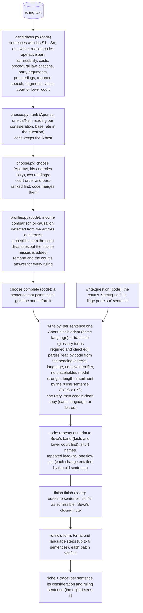

# Extract: the fiche built from the ruling's own sentences (summaries v1)

> **Status: PROPOSED, 28 Nov 2026.** Code: `src/summarize/extract/`. Tests: `tests/test_extract.py` (fake transport
> only, a pipeline test on the test database, and three real rulings DE/FR/IT for the filter). Measurement:
> `eval/extract_eval.py`, aggregates in `results/extract_*.json`. In the pipeline with `SUMMARY_WRITER=extract`
> (set in `.env.example`) or `--writer extract`; the code's default stays `v2`.

## 1. Why

Suva's fiches are mostly the ruling's own sentences, lightly adapted. On the 53 rulings with a fiche in their own
language, 74 % of Suva's sentences share at least half their words with one ruling sentence, taken from the
considerations (323) or the facts (106), almost never from the operative part (7) (exploratory count, 28 Nov,
over all 53, so it was not used to tune). The v2 fiches restate other passages: 3 to 8 % of Suva's sentences and
12 to 26 % of its considerations (27 drafts of the development sets). Refine patches v2's sentences and cannot
change what they are about (`docs/REFINE.md` §6).

## 2. How

Rules every step keeps: Apertus only chooses ids or writes one sentence; every identifier comes from the ruling
(G1); every written sentence is entailed by the ruling sentence it restates; a rule is a legal or linguistic
category, never a phrase of one ruling (the audit below); a fiche the writer cannot produce falls back to v2.

## 3. Measured on the iterate set (12 rulings; the holdout set is not yet run)

| Run | Change | Suva's sentences chosen | Suva's considerations |
|---|---|---|---|
| v2 drafts | the current pipeline | 3 to 8 % | 12 to 26 % |
| c1 | one call chooses | 11 % | 26 % |
| c3 | rank considerations, then choose | 24 % | 45 % |
| c6 | reported speech out, code tags | 29 % | 57 % |
| c10 | profiles, court's answer | 40 % | 66 % |
| c12 | voice, wider party filter | 35 % | 62 % |

Two near-identical runs differ by about ±0.07 on 11 rulings. Bars written before measuring (`eval/extract_eval.py`):
X-F1 filter keeps ≥ 0.90 of Suva's sentences (0.95); X-C1 ≥ 0.40; X-C2 ≥ 0.60; X-C3 ≥ 0.20 over random.

Rule audit (code only, 28 development rulings): every filter fires on 15 to 28 rulings except citations (1);
lower-court voice 12; profiles 10 (income comparison 6, causation 4); remand 5; the court's answer exists in 21;
the question sentence is found in 25; the heading is parsed in 26; the term Wagnis appears in 2 (a statutory term,
Art. 50 UVV).

## 4. Open

- The holdout set (16 rulings) has not been run: every number above is on the set the rules were tuned on.
- The LLM judge reads ATSG and LPGA as different acts and failed correct German citations (`docs/REFINE.md` §6);
  its numbers for this writer are not used.
- About 60 Apertus calls per ruling for both languages (v2: 2 to 4); 30 to 90 s per ruling.
- The fiches read as a sequence of the court's sentences; some grammar slips survive the polish.
- The glossary in the prompt is followed (32 of 34 translated sentences used every required term on the first
  attempt); a run without it would measure what it adds.
