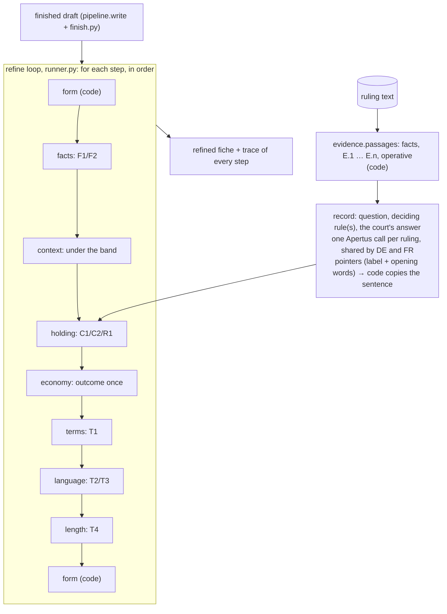

# Refine: step-by-step improvement of a summary

> **Status: PROPOSED, 28 Nov 2026.** Code: `src/summarize/refine/`. Tests: `tests/test_refine.py` (fake transport only,
> plus three real rulings DE/FR/IT from the database). Measurement: `eval/refine_eval.py`, results in
> `results/refine_eval_*.json`. Off by default in the pipeline (`--refine` or `SUMMARY_REFINE=1`).

## 1. What it does

The current pipeline writes a German and a French fiche and finishes them by code (`pipeline.write`,
`finish.finish`). Refine then improves each finished fiche **one concern at a time**, in a fixed order set in code.
Each step asks Apertus a narrow question with a closed answer format; code checks the answer and keeps an edit only
if it is proven. *Apertus interprets, code verifies, the lawyer decides.*



## 2. The contract every step follows

| Rule | How it is enforced |
|---|---|
| The model never chooses what runs next | `steps.default_steps()` is a list; `runner.refine` walks it |
| One step, one concern | each step file targets named judge criteria and nothing else |
| Ids, never free text | sentences are `s1…sn`, passages `facts`, `E.4.2`, `operative`; the JSON format lists them as enums and `model._valid` rejects any other id |
| Evidence is the ruling's own text | the model gives a passage label and the opening words of a sentence; `evidence.find` copies the sentence from the ruling (longest matching prefix of 12 to 5 words, parentheticals ignored), or the item is rejected |
| Everything written is entailed | `entail.gate`: the ruling passage an edit rests on (or the sentence it rewords) must say everything the new sentence says, read as P(Ja) from the first token, kept at 0.9 or more; the reading is in the trace |
| A rule is anchored in law | `record.anchored`: a rule of the record must carry an article, a case-law reference or the court's case-law formula |
| No near-duplicates, no new terms of art | `common.repeats` refuses an insert that shares most words with a sentence of the draft; `common.new_terms` refuses a rewording that brings in a glossary or procedural term |
| Patches, not rewrites | `draft.Patch`: replace (a sentence or a span), delete, insert; the outcome sentence and the closing note are locked |
| No new identifier (G1) | `checks.new_identifiers`: every article, consideration and number in a model-written sentence must be in the ruling |
| Monotonic | `runner.attempt`: a patch is kept only if its own check passes and no code check has more findings than before |
| Bounded, fail-closed | a call budget per summary; an invalid answer gets one retry that names the error, then the item is `needs_review` |
| Everything traced | `Outcome` per step: status (`passed`, `corrected`, `needs_review`, `skipped`), findings, the patch, why it was refused, calls |
| One gateway (G2) | `model.gateway` goes through `src/llm/client.py`: cache, replay, served-model check, call log |

## 3. The steps

| Step | Kind | Detect | Repair | Kept only if |
|---|---|---|---|---|
| `form` | code | citation forms of the other language, foreign abbreviations, ß, Markdown, invented consideration references, a repeated sentence | code | always (deterministic) |
| `facts` | model | per sentence: the ruling sentence that states it and a verdict (same, stronger, different, not in the ruling); code adds "names Suva when the ruling names another insurer" | rewrite from a ruling sentence; delete only a sentence the ruling does not state at all, after a second reading agrees | the pointer is found, no new identifier, the fiche's language, entailed by the passage |
| `context` | model | under Suva's word band (code) | one or two sentences of facts | no new identifier, no near-duplicate, entailed by the facts of the ruling |
| `holding` | model | for every rule of the record (up to three) and the court's answer: the sentence that states it, or none | one sentence per missing rule, inserted before the last sentence; code adds the consideration reference | no new identifier, no near-duplicate, each sentence entailed by the rule it restates |
| `economy` | model | a sentence restating the Federal Supreme Court's outcome next to the code-written outcome sentence (code) | the sentence without the outcome, or delete | the outcome is gone, nothing longer, no new term, entailed by the old sentence |
| `terms` | code + model | a term of the other language from the glossary (code); up to four terms Apertus would change | span replacement | the replacement is attested: glossary, the ruling in the fiche's language, or Suva's summaries |
| `language` | model | placeholders and foreign sentences (code); up to three sentences Apertus would rewrite | rewrite one sentence | same articles, references and numbers; same language; length 0.6–1.5×; no placeholder; no new term of art; entailed by the old sentence (for a placeholder, by the facts and the old sentence) |
| `length` | model | over the band (code) | delete the least important sentences, ranked by Apertus | stops inside the band |

## 4. Gateway lessons (measured 28 Nov 2026)

- Strict `json_schema` decoding of a long ruling looped on whitespace until `max_tokens` (1,800 blank tokens,
  161 s; then 502 from the gateway at 120 s). JSON mode (`json_object`) with the format stated in the prompt and
  validated by code works.
- Asked to quote, the model copied whole paragraphs and ran out of tokens. Pointers (label + opening words) cost a
  few tokens, and the evidence is then the ruling's own sentence.
- Every call that reads the ruling starts with the same system message and labelled ruling (`evidence.messages`),
  so the gateway's prefix cache reads it once per ruling.

- The model writes whole sentences, paraphrased at the end, as its "opening words", and drops parentheticals:
  matching the longest prefix with parentheticals ignored took the records from 6 to 12 checked of 12.
- Asking Apertus to search the whole ruling again for a sentence it just wrote let through rewrites that added a
  condition (run r2: F2 1.0 → 0.79). A narrow two-text entailment question read from log-probabilities splits
  cleanly (most readings near 0 or 1, run r7) and caught them.

## 4b. What each round changed (iterate set, 24 summaries, judge repetition 0)

| Run | Change | Mean | Usable | F1 | F2 | C1 | T1 | T3 | T4 |
|---|---|---|---|---|---|---|---|---|---|
| draft | the current pipeline | 0.758 | 0.583 | 0.75 | 1.00 | 0.87 | 0.83 | 0.54 | 0.79 |
| r1 | first loop | 0.771 | 0.542 | 0.73 | 0.88 | 0.88 | 0.83 | 0.75 | 0.74 |
| r2 | fixes from r1 (no entailment gate) | 0.739 | 0.292 | 0.68 | 0.79 | 0.92 | 0.67 | 0.70 | 0.67 |
| r7 | entailment gate, pointers by prefix, anchored rules, glossary in prompts | 0.779 | 0.583 | 0.83 | 1.00 | 0.96 | 0.79 | 0.67 | 0.79 |

Source: `results/refine_eval_iterate_r1.json`, `…_r2.json`, `…_r7.json`. Judge numbers are provisional.

## 5. Measurement

`eval/refine_eval.py` on two disjoint sets of the judge's development rulings (`iterate` for tuning, `holdout`
run once at the end; the judge's test split is never used). Pass bars are written in the file before measuring
(G10). The judge (`eval/judge/`, not Apertus) is not validated with its current rubric (`docs/JUDGE.md` §5), so
every judge number is provisional.

```bash
uv run python -m eval.refine_eval drafts --set iterate            # the current pipeline's fiches
uv run python -m eval.refine_eval refine --set iterate --name r1  # refine them
uv run python -m eval.refine_eval judge  --set iterate --name r1  # judge before and after
uv run python -m eval.refine_eval report --set iterate --name r1  # results/refine_eval_iterate_r1.json
uv run python -m eval.refine_eval show   --set iterate --name r1  # every edit, kept or refused, and why
```

Results: section 6, filled from `results/` only.

## 6. Results

(pending)
