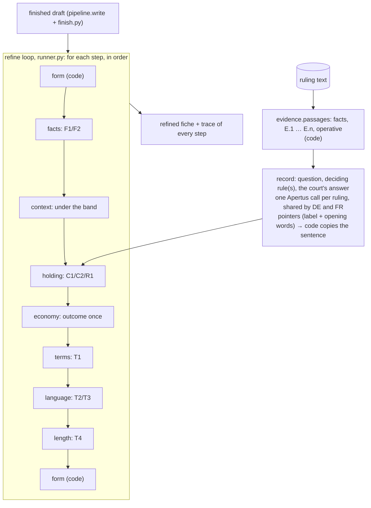

# Refine: step-by-step improvement of a summary

> **Status: PROPOSED, 28 Nov 2026.** Code: `src/summarize/refine/`. Tests: `tests/test_refine.py` (fake transport only,
> plus three real rulings DE/FR/IT from the database). Measurement: `eval/refine_eval.py`, results in
> `results/refine_eval_*.json`. Off by default in the pipeline (`--refine` or `SUMMARY_REFINE=1`).

## 1. What it does

The current pipeline writes a German and a French fiche and finishes them by code (`pipeline.write`,
`finish.finish`). Refine then improves each finished fiche **one concern at a time**, in a fixed order set in code.
Each step asks Apertus a narrow question with a closed answer format; code checks the answer and keeps an edit only
if it is proven. *Apertus interprets, code verifies, the lawyer decides.*



## 2. The contract every step follows

| Rule | How it is enforced |
|---|---|
| The model never chooses what runs next | `steps.default_steps()` is a list; `runner.refine` walks it |
| One step, one concern | each step file targets named judge criteria and nothing else |
| Ids, never free text | sentences are `s1…sn`, passages `facts`, `E.4.2`, `operative`; the JSON format lists them as enums and `model._valid` rejects any other id |
| Evidence is the ruling's own text | the model gives a passage label and the opening words of a sentence; `evidence.find` copies the sentence from the ruling, or the item is rejected |
| Patches, not rewrites | `draft.Patch`: replace (a sentence or a span), delete, insert; the outcome sentence and the closing note are locked |
| No new identifier (G1) | `checks.new_identifiers`: every article, consideration and number in a model-written sentence must be in the ruling |
| Monotonic | `runner.attempt`: a patch is kept only if its own check passes and no code check has more findings than before |
| Bounded, fail-closed | a call budget per summary; an invalid answer gets one retry that names the error, then the item is `needs_review` |
| Everything traced | `Outcome` per step: status (`passed`, `corrected`, `needs_review`, `skipped`), findings, the patch, why it was refused, calls |
| One gateway (G2) | `model.gateway` goes through `src/llm/client.py`: cache, replay, served-model check, call log |

## 3. The steps

| Step | Kind | Detect | Repair | Kept only if |
|---|---|---|---|---|
| `form` | code | citation forms of the other language, foreign abbreviations, ß, Markdown, invented consideration references, a repeated sentence | code | always (deterministic) |
| `facts` | model | per sentence: the ruling sentence that states it and a verdict (same, stronger, different, not in the ruling); code adds "names Suva when the ruling names another insurer" | rewrite from a ruling sentence, or delete | the pointer is found, no new identifier, the fiche's language, a re-check says "same" |
| `context` | model | under Suva's word band (code) | one or two sentences of facts, pointing at the ruling | same as facts |
| `holding` | model | which sentence states the record's rule and the court's answer, or none | insert the rule and its application; code adds the consideration reference | no new identifier, a re-check finds the rule |
| `economy` | model | a sentence restating the outcome the code-written outcome sentence states (code) | the sentence without the outcome, or delete | the outcome is gone, nothing longer, no new identifier |
| `terms` | code + model | a term of the other language from the glossary (code); up to four terms Apertus would change | span replacement | the replacement is attested: glossary, the ruling in the fiche's language, or Suva's summaries |
| `language` | model | placeholders and foreign sentences (code); up to three sentences Apertus would rewrite | rewrite one sentence | same articles, references and numbers; same language; length 0.6–1.5×; no placeholder |
| `length` | model | over the band (code) | delete the least important sentences, ranked by Apertus | stops inside the band |

## 4. Gateway lessons (measured 28 Nov 2026)

- Strict `json_schema` decoding of a long ruling looped on whitespace until `max_tokens` (1,800 blank tokens,
  161 s; then 502 from the gateway at 120 s). JSON mode (`json_object`) with the format stated in the prompt and
  validated by code works.
- Asked to quote, the model copied whole paragraphs and ran out of tokens. Pointers (label + opening words) cost a
  few tokens, and the evidence is then the ruling's own sentence.
- Every call that reads the ruling starts with the same system message and labelled ruling (`evidence.messages`),
  so the gateway's prefix cache reads it once per ruling.

## 5. Measurement

`eval/refine_eval.py` on two disjoint sets of the judge's development rulings (`iterate` for tuning, `holdout`
run once at the end; the judge's test split is never used). Pass bars are written in the file before measuring
(G10). The judge (`eval/judge/`, not Apertus) is not validated with its current rubric (`docs/JUDGE.md` §5), so
every judge number is provisional.

```bash
uv run python -m eval.refine_eval drafts --set iterate            # the current pipeline's fiches
uv run python -m eval.refine_eval refine --set iterate --name r1  # refine them
uv run python -m eval.refine_eval judge  --set iterate --name r1  # judge before and after
uv run python -m eval.refine_eval report --set iterate --name r1  # results/refine_eval_iterate_r1.json
uv run python -m eval.refine_eval show   --set iterate --name r1  # every edit, kept or refused, and why
```

Results: section 6, filled from `results/` only.

## 6. Results

(pending)
