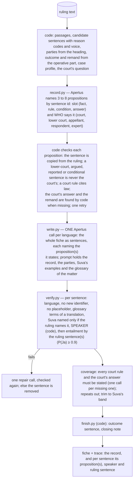

# Summaries v3: checked record, one written fiche, every sentence verified

> **Status: PROPOSED, 28 Nov 2026.** Code: `src/summarize/v3/` (branch `summarize/v3`). Tests:
> `tests/test_v3_record.py`, `test_v3_write.py`, `test_v3_verify.py` (fake transport only). Run live on four
> tuning rulings; not yet measured on a fresh set. In the pipeline with `SUMMARY_WRITER=v3` or `--writer v3`;
> the code's default stays `v2`, which also stands in for any language v3 cannot write.

## 1. Why

Measured on 28 Nov (`docs/EXTRACT.md`, `docs/REFINE.md`): the prompt writer (v2) is fluent and mostly faithful but
often leaves out the rule that decides the case; the extractive writer states the rule but confuses who says what
(a party's argument or the lower court's reasoning given as the Federal Supreme Court's holding). v3 decides what
the fiche must say, and who says it, before anything is written, lets Apertus write the fiche as a whole, and
has code check every sentence.

## 2. How

About 10 to 16 Apertus calls per fiche and 20 to 50 s per ruling for both languages (live, 28 Nov). Every call
goes through `src/llm/client.py`, so a run replays from the cache with no gateway call (checked: 0.3 s per ruling).

## 3. For the interface (handoff)

- **Switch on:** `SUMMARY_WRITER=v3` in `.env`, or `python -m src.summarize.pipeline --dockets 8C_… --writer v3`.
  `summarise_ruling(conn, ruling_id, writer="v3", mode="live" | "replay")` is the one entry point.
- **Stored:** `model_runs.params.writer = {"de": "v3" | "v2", "fr": …}`; `params.extract_errors` says why a language
  fell back to v2; `params.refine[language].steps` holds the trace (the same place refine and extract use), so
  `workspace.ruling_page(...)["summaries"][language]["checks"]` already returns it. No schema change.
- **The trace, two steps:**
  - `record`: `findings[]` = the propositions: `reason` ("P3 rule, said by: court"), `evidence` (the
    consideration, "E.3.1"), `quote` (the ruling's sentence), `accepted: true`; `note` = what code refused or changed.
  - `verify`: `findings[]` = every written sentence: `text`, `status` ("written" | "repaired" | "removed"),
    `accepted`, `reason` (its propositions and speakers), `evidence` (considerations), `quote` (the ruling
    sentence(s) it rests on), `why_not` (the failed checks); then one entry per required proposition no sentence
    states (`reason: "P4 not stated"`). `status`: "passed" or "needs_review".
- **What the interface can show from it:** per summary sentence, the consideration and the ruling sentence behind
  it (source link); a "needs review" badge with the reasons; the record as "what this summary had to say".
  `workspace.refine_checks` passes `reason, accepted, evidence, quote, why_not` through today; `text` and `status`
  are in the stored trace but not yet in that function's whitelist (one line in `src/suva_app/workspace.py`).
- **Not done:** no React change; `make run` not run with v3; the Italian ruling tested (8C_135/2025) gives the
  weakest fiche.

## 4. Known limits

- The summaries are compact (about 130 to 230 words) and rule-centred; grammar slips survive.
- A sentence that fails its checks twice is left out: a fiche can lack a point and says so (`needs_review`).
- Numbers written "17,54%" against "17.54 %" in the ruling are refused (format, not content).
- No comparison with v2 on unseen rulings yet.
